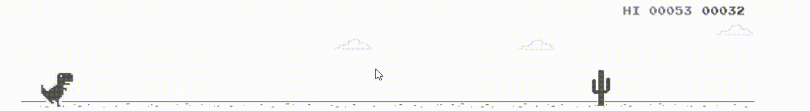
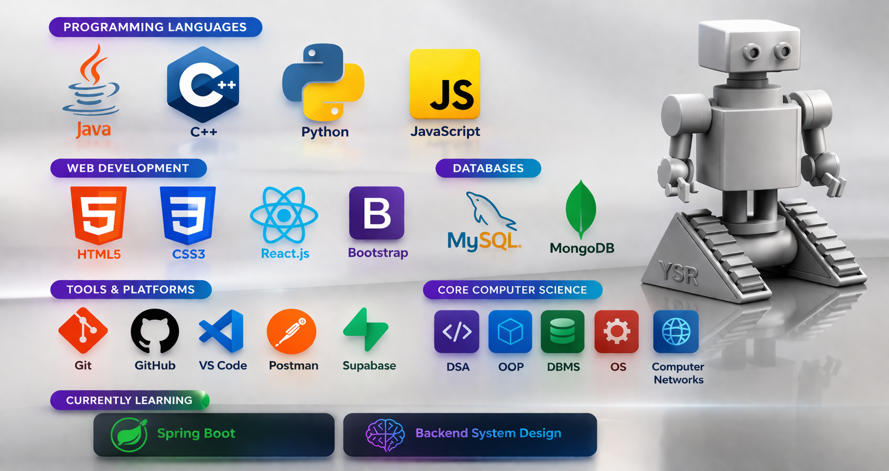

  

---

<h1 align="center">
  
</h1>

---

## 💡 What do I know?

- 🚀 Full Stack Development (React + Java Backend)  
- 🤖 AI/ML Development & Intelligent Systems  
- 🧠 Strong in DSA, OOP, DBMS, OS, Computer Networks  
- 🏆 Hackathon Builder & Competitive Programmer  

---

## 💻 My Tech Stack

---

## 🎬 Dev Vibes

---

## 🧠 What I Focus On

- Backend Engineering (Java + Spring Boot)  
- Full Stack Development (React.js)  
- Database Systems (MySQL, MongoDB)  
- AI/ML + Automation  

---

## ⚡ Fun Facts / Hobbies

- 🏊 Swimming  
- 📖 Enjoy reading fiction  
- ♟️ Playing chess  
- 🧠 Solving Rubik's Cube  

---

## 🌐 Where to find me

---

## 📌 Featured Work

---

---

✨ Building scalable systems, not just writing code ✨

